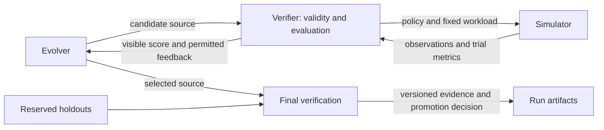

# Architecture and refactoring audit

The reusable pattern is a simulator, an evolver, and a verifier. The simulator
models what happens, the evolver proposes programs, and the verifier decides
whether a program is valid and how its behavior scores. Workload preparation,
isolation, and evidence storage support those three responsibilities.

## The loop and its trust boundary

Search and final verification can share evaluation machinery while using
different data access and feedback rules. A hidden score must not become another
search objective. During search, the candidate cannot change the workload,
simulator semantics, scoring rules, or verifier identity. Changes to those
components define a new experiment and require their own versioning and review.

Here, “verifier” means several existing components together: static candidate
validation, isolated execution, trial evaluation, scoring, score identity, and
promotion checks. `evaluators/verifier.py` alone owns only score identity and
comparability. Simulation results establish behavior under the modeled
conditions; promotion gates do not prove performance in a real serving stack.

## Audit findings and changes

| Finding | Refactoring decision |
| --- | --- |
| A 2,122-line evaluator module owned simulation, evaluation, and policy construction. | Give each responsibility an owning module; retain the original module as a compatibility facade. |
| Core panel preparation imported trace replay from the application package. | Move metadata replay into `evaluators/trace_replay.py`; retain the old import path as a facade. |
| Package initialization eagerly loaded application primitives for every core import. | Resolve historical top-level primitive exports lazily; keep their implementations and public names unchanged. |
| The runner combined CLI composition with run archival and post-search reports. | Extract `RunArtifactWriter`, with explicit panel, baseline evaluation, and incumbent dependencies. Keep the existing public save function as a composition wrapper. |
| Rediscovery analysis imported a private runner helper. | Compose `CandidatePanelBuilder` directly in the analysis tool. |
| Artifact tests relied on runner globals and lived in the evaluator test module. | Move them to `test_run_artifacts.py` and supply service dependencies directly. Keep integration coverage for CLI wiring and trace quarantine. |

## Ownership and dependencies

| Owner | Responsibility |
| --- | --- |
| `evaluators/contracts.py` | Candidate-visible policy capabilities and observation types. |
| `evaluators/simulator.py` | Prefix-tree state transitions, resource accounting, diagnostics, and trial measurements. |
| `evaluators/panels.py`, `workloads.py`, `trace_replay.py` | Deterministic request streams, trace geometry, and panel preparation. |
| `evaluators/evaluation.py`, `scoring.py` | Trial orchestration, aggregation, and scoring. Evaluation consumes a small `Simulation` protocol. |
| `evaluators/policy_factory.py` | Factory signature adaptation and composition of fixed admission with candidate eviction. |
| `problems/prefix_kv_cache/candidate_validation.py`, `candidate_panels.py`, `sandbox.py` | Cache candidate source checks, isolated evaluation, and explicit panel selection. |
| `workflow/` | Evolution workflow and Levi adaptation, with replaceable runner and reporter capabilities. |
| `problems/prefix_kv_cache/run_artifacts.py` | Input snapshots, archived alternatives, comparison reports, and specialist adjudication evidence. |
| `problems/prefix_kv_cache/runner.py` | Command handling and construction of the services above. |

Core evaluation can be imported without the application, command tools, or
evolution engine. Application code depends on core contracts and measurements.
The CLI composes services; services do not import the CLI to find dependencies.
Compatibility facades preserve historical policy imports, while new internal
callers import from the owning modules.

## Applying SOLID

- **Single responsibility:** simulator mechanics, evaluation, and artifact
  persistence have separate owners and reasons to change.
- **Open/closed:** alternative simulation implementations and evaluation
  callbacks can be supplied through existing constructors. Supporting them does
  not require editing the consumer's orchestration logic.
- **Liskov substitution:** substitutes must honor the same input semantics,
  invalid-candidate behavior, and result contract. A matching method signature
  alone is insufficient; factory adaptation still preserves exceptions raised
  inside a candidate instead of interpreting them as signature mismatches.
- **Interface segregation:** evaluation needs `Simulation.run`, not simulator
  internals. Existing policy, baseline capability, runner, and reporter
  protocols remain small; there is no universal base class.
- **Dependency inversion:** expensive evaluation operations are explicit
  dependencies of panel and artifact services. Reporting no longer retrieves
  them indirectly from runner globals.

The simulator still contains a substantial request-processing state machine.
Its accounting and invariants are coupled: splitting it into many small classes
solely to reduce line count would obscure transitions. The runner also retains
CLI options and several report commands, and artifact persistence retains
domain-specific promotion rules. Those are remaining seams to revisit when a
concrete behavior change or another consumer requires them.

## What can be generalized

The existing `EvolutionWorkflow`, runner/reporter protocols, source-aware Levi
adapter, and isolated candidate execution offer reusable pieces. A future
problem adapter would supply its candidate contract, workload preparation,
execution environment, objective, feedback policy, baselines, and final gates.
Cache block types, hit-rate formulas, replay formats, and specialist composition
remain part of this problem.

The current `Simulation` protocol is deliberately cache-specific. A scheduler
simulator would produce scheduler observations, not `TrialMetrics` with cache
hit rates. A broader framework should keep those types at the domain boundary
and share an evaluation envelope containing validity, objective values,
permitted feedback, provenance, and artifact references. Real execution or
replay could fulfill the same experiment role as simulation.

The next useful generalization test is one small second domain, such as a queue
scheduler, using the same propose/evaluate/archive workflow. Require it to run
without importing cache contracts. Extract the shared API from that evidence;
do not assume that the current configuration or scalar fitness interface
already supports every domain. This refactor establishes boundaries but does
not add a second domain, generic plugin registry, or new search backend.

## Preservation and verification

This refactor preserves policy sources, incumbent bundles, scoring formulas,
verifier versions, replay semantics, and artifact schemas. Policy code is
experimental input, so changing its formatting would change complexity and
provenance even when behavior appears identical.

Validation includes full functional and property tests, coverage gates, type
checking, linting, and formatting. A separate before/after comparison checks
complete results and workload manifests for LRU, TinyLFU-LRU, and the production
incumbent on both synthetic and mixed trace panels. The pinned discovery
manifest and immutable policy hashes provide additional reproducibility checks.

Completed checks for this refactor (2026-09-10):

- 581 tests passed on Python 3.11; total coverage was 86.82%, and the candidate
  isolation/validation coverage gate passed at 85%.
- `ruff format .`, `ruff check .`, and `mypy` passed (103 source files typed).
- All six before/after evaluations matched exactly, including trial metrics,
  scores, and workload manifests. The discovery manifest matched its reference.
- All 35 tracked policy, seed, and incumbent bundle files matched `HEAD`
  byte-for-byte; all four registered incumbents validated.
- Source and wheel builds, isolated wheel resource and CLI checks, and candidate
  evaluation in the local sandbox image passed. The container smoke test used
  no network, a read-only filesystem, and the unchanged production policy.
